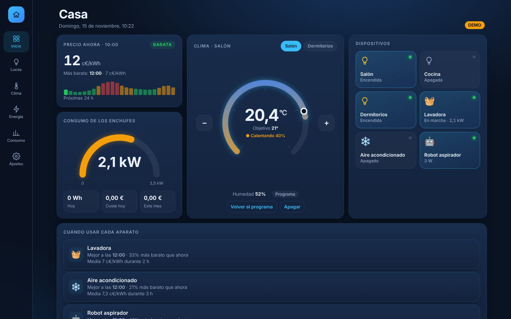

# 🏠 Centro de control de casa



Panel para el móvil y el ordenador que junta en un solo sitio:

- 💡 **Luces Philips Hue** (encender, apagar, brillo por habitación)
- 🌡️ **Calefacción tado° X** (temperatura, subir/bajar, volver al horario)
- 🔌 **Enchufes Shelly**: cuánto gasta cada aparato y **cuánto cuesta en euros** al día y al mes
- ⚡ **Precio de la luz** de cada hora (PVPC) o tu tarifa fija / de 3 tramos
- 📊 **Consumo de toda la casa** con el archivo de tu distribuidora y **comparador de tarifas** con tu consumo real

No hace falta tener todo: usa lo que tengas (solo luces, solo enchufes…).

---

## ¿Cómo funciona?

El programa se instala en **un ordenador de tu casa que esté siempre encendido** (o casi) y desde ahí habla con tus aparatos por la Wi-Fi. Luego lo abres desde el iPhone, iPad u ordenador **conectados a la Wi-Fi de casa**.

| Si tienes… | Dónde instalarlo |
|---|---|
| Un **PC con Windows** | En el PC |
| Un **Mac** | En el Mac |
| **Solo iPhone / iPad** | Un iPhone o iPad no puede tenerlo funcionando siempre. Necesitas una **Raspberry Pi** (unos 60–80 €, gasta 3 W) |

> Tus datos (claves de Hue y tado, consumos) se guardan **solo en tu ordenador**, en `config.json` y la carpeta `data/`. No se envían a ningún sitio.

---

## ⭐ Instalación fácil (recomendada)

El instalador lo hace todo solo: instala Node.js si falta, copia el programa a una carpeta fija, abre el cortafuegos para el móvil, lo deja arrancando solo al encender, evita que el ordenador se duerma (te lo pregunta) y al final **te dice la dirección que tienes que escribir en el iPhone**.

### 🪟 Windows

**Opción 1 — una línea (lo más fácil):**
1. Pulsa la tecla **Windows**, escribe `powershell` y abre **Windows PowerShell**.
2. Copia esta línea, pégala (clic derecho) y pulsa **Enter**:
   ```
   irm https://raw.githubusercontent.com/ezguum-zuri/centro-domotico/main/arranque/instalar-windows.ps1 | iex
   ```
3. Cuando Windows pregunte *«¿Quieres permitir que esta aplicación haga cambios?»*, pulsa **Sí** (saldrá 1 o 2 veces).

**Opción 2 — con el ZIP:**
1. En GitHub pulsa **Code → Download ZIP** y descomprímelo (clic derecho → *Extraer todo*).
2. Dentro de la carpeta, doble clic en **`INSTALAR-Windows.bat`**.
   Si sale *«Windows protegió su PC»*: **Más información → Ejecutar de todas formas**.

### 🍎 Mac

1. Abre la app **Terminal** (Cmd + espacio, escribe *Terminal*).
2. Pega esta línea y pulsa **Enter**:
   ```
   curl -fsSL https://raw.githubusercontent.com/ezguum-zuri/centro-domotico/main/instalar.sh | bash
   ```
3. Si te pide la **contraseña del Mac**, escríbela (no se ve al escribir) y pulsa Enter.

**Opción 2 — con el ZIP:** descárgalo de GitHub (**Code → Download ZIP**), ábrelo y haz doble clic en **`INSTALAR-Mac.command`**.
Si el Mac dice que *no puede comprobar el desarrollador*: **Ajustes del Sistema → Privacidad y seguridad → Abrir igualmente** (abajo del todo), y vuelve a hacer doble clic.

### 🍓 Raspberry Pi (para quien solo tiene iPhone / iPad)

1. Prepara la Raspberry con **Raspberry Pi Imager** (sistema *Raspberry Pi OS Lite*), poniendo tu Wi-Fi, un usuario y activando SSH.
2. Conéctate a ella por SSH (desde un ordenador, o desde el iPad con una app como *Termius*) y pega la **misma línea que en Mac**:
   ```
   curl -fsSL https://raw.githubusercontent.com/ezguum-zuri/centro-domotico/main/instalar.sh | bash
   ```

### 🔄 Actualizar a una versión nueva

Ejecuta **otra vez el mismo instalador**. Descarga la versión nueva y **no toca tu configuración ni tus datos**.
Si en el móvil sigue saliendo el diseño anterior, cierra la app y vuelve a abrirla.

---

## 📱 Abrirlo desde el iPhone / iPad

El instalador te dice la dirección al terminar. Con el móvil en la **Wi-Fi de casa**, ábrela en Safari, por ejemplo:

- **Mac / Raspberry:** `http://NOMBRE-DEL-EQUIPO.local:8080`
- **Windows:** `http://192.168.1.XX:8080`

Luego **Compartir → Añadir a pantalla de inicio** y queda como una app.

En el móvil el menú sale abajo; en el ordenador o el iPad en horizontal, como barra lateral.

> En Windows, si un día el móvil deja de conectar, el router le ha cambiado la dirección al PC. Vuelve a ejecutar el instalador y te dirá la nueva (o reserva la IP del PC en el router).

---

## ⚙️ Configurar (pestaña Ajustes)

**Tarifa de la luz**: elige PVPC, 3 tramos (pon tus precios de punta/llano/valle) o precio único. Los precios están en tu factura ("término de energía", sin impuestos).

**Philips Hue**: pulsa *Buscar*, aprieta el botón redondo del Bridge y en menos de 30 s pulsa *Vincular Bridge*.

**Enchufes Shelly** (modelos Gen3/Gen4, p. ej. *Shelly Plug M Gen3*):
1. Primero conéctalos a tu Wi-Fi. Lo más fácil: **app Casa del iPhone → + → Añadir accesorio → escanear el QR** del enchufe (necesitas un HomePod o Apple TV en casa). También vale la app *Shelly Smart Control*.
2. En el panel pulsa **🔍 Buscar enchufes en la red**, pulsa **Añadir** en cada uno, ponle nombre y guarda. Para saber cuál es cuál, mira los vatios que marca o apaga uno desde la app Casa y vuelve a buscar.
3. Marca **"Pedir confirmación antes de apagar"** en nevera, lavadora, etc., y **"Detectar cada uso y su coste"** en lavadora, lavavajillas o secadora.
4. Si el router le cambia la IP a un enchufe, el panel lo vuelve a encontrar solo.

> ⚠️ Nevera, congelador: no los apagues nunca desde el panel. Cinta de correr o aparatos con motor potente: mejor directos a la pared, sin enchufe inteligente.

**tado° X**: *Vincular cuenta tado* → inicia sesión en la web de tado y confirma el código. Sin suscripción, tado permite ~100 consultas al día, por eso se actualiza cada hora.

**Consumo de toda la casa (pestaña Consumo)**: descarga de la web de tu distribuidora el archivo de **consumo horario / curvas de carga** (i-DE: Área Privada → Gestiones; e-distribución, UFD… tienen opciones parecidas) y súbelo con *Importar archivo CSV*. En *Ofertas a comparar* pon las tarifas que te ofrezcan y verás cuál te sale más barata con tu consumo real, incluido el PVPC hora a hora.

---

## 🛠️ Instalación manual (solo si el instalador falla)

1. Descarga el ZIP de GitHub y mueve la carpeta a un sitio fijo (Windows: `C:\Users\TU-USUARIO\centro-domotico`; Mac: tu carpeta de usuario).
2. Instala **Node.js LTS** desde https://nodejs.org.
3. **Windows:** en la carpeta `arranque`, doble clic en `windows-instalar.bat`. La primera vez que Windows pregunte por Node.js, marca **Redes privadas → Permitir**.
   **Mac:** en Terminal, `cd` + arrastra la carpeta + Enter, y luego `bash arranque/mac-instalar.sh`.
   **Raspberry:** dentro de la carpeta, `bash arranque/raspberry-instalar.sh`.
4. Quitar el arranque automático: `windows-quitar.bat` · `bash arranque/mac-quitar.sh` · `sudo systemctl disable --now centro-domotico`.
5. Reiniciar: `windows-reiniciar.bat` · `bash arranque/mac-reiniciar.sh` · `sudo systemctl restart centro-domotico`.

## 🧪 Probarlo sin aparatos

`DEMO=1 node server.js` (Mac/Raspberry) o `set DEMO=1 && node server.js` (Windows) y abre http://localhost:8080.

---

### Para quien suba esto a GitHub

- El archivo `.gitignore` evita que se suban `config.json` y `data/`. **Nunca subas tu propia carpeta de uso diario a mano**: sube solo los archivos del programa.
- Los instaladores descargan de `ezguum-zuri/centro-domotico` (rama `main`). Si el repositorio se llama distinto, cambia la línea `REPO=` en `instalar.sh` y `$REPO =` en `arranque/instalar-windows.ps1`, y las direcciones de este README.
